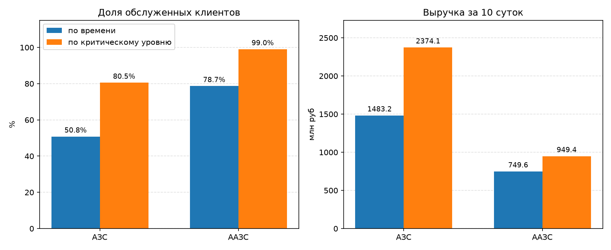
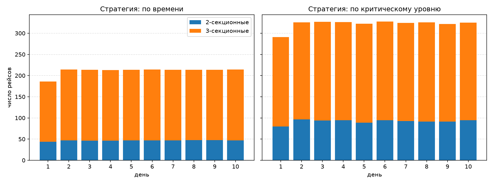

# Отчёт по ИДЗ: имитационная модель сети АЗС (задание А7)
 
Выполнили: Бутько Валерия, Трофимова Анастасия
 
## 1. Условие и требования
 
**Объект.** Сеть из 8 стационарных АЗС и 12 мини-АЗС (ААЗС). У АЗС четыре вида топлива с ёмкостями баков: 92 — 30000 л, 95 — 16000 л, 98 — 16000 л, ДТ — 30000 л. У ААЗС только 92 (16000 л) и 95 (15000 л). На АЗС 4 топливораздаточные колонки (ТРК), на ААЗС 2; каждая ТРК обслуживает 2 авто одновременно.
 
**Клиенты.** Приезжают на каждую ТРК с интервалом Random(3). Объём заправки Random(180)+20 л, вид топлива равновероятен. Распределение: клиенты с 98 и ДТ едут на АЗС; клиенты с 92 и 95 с вероятностью 50 % едут на АЗС, иначе на ААЗС. Цены, руб/л: 92 — 63,6; 95 — 66,25; 98 — 68,5; ДТ — 67,2.
 
**Снабжение.** Наёмные бензовозы с 2–3 секциями по 6000 л, один рейс может обслуживать несколько станций. В секции один вид топлива, секция сливается полностью. Две стратегии: (1) по критическому уровню топлива, (2) по времени. На каждой станции есть менеджер, который учитывает приход, расход и прибыль.
 
**Что требуется.** Смоделировать 10 дней (потребление и снабжение) и оценить: долю обслуженных клиентов по АЗС и ААЗС, выручку по АЗС и ААЗС, количество рейсов 2- и 3-секционных бензовозов по дням.
 
## 2. Допущения и их обоснование
 
В условии не заданы или противоречат друг другу несколько параметров, поэтому приняты следующие допущения.
 
| № | Допущение | Почему |
| :---: | --- | --- |
| 1 | Время в минутах, Random(3) — равномерное на [0; 3] мин | В условии нет единиц времени; минуты естественны для заправки |
| 2 | Ёмкости баков берутся по видам топлива | Условие противоречиво (общий объём 42000/24000 л и ёмкости по видам); ёмкости по видам подробнее |
| 3 | Клиенты приходят общим потоком с интервалом Random(3)/56 (56 — число ТРК в сети), затем распределяются по правилам условия | Приход «на каждую ТРК» противоречит распределению клиентов по типам станций; общий поток сохраняет суммарную нагрузку и позволяет применить правила распределения |
| 4 | Скорость заправки 40 л/мин; ТРК = 2 канала обслуживания | В условии нет скорости заправки |
| 5 | Клиент ждёт колонку не дольше 5 мин; если топлива в баке меньше нужного объёма, уезжает необслуженным | Нужно определить, кто считается необслуженным, чтобы посчитать долю обслуженных |
| 6 | Парк бензовозов неограничен; до первой станции 60 мин, между станциями 15 мин | Условие говорит о парке наёмных бензовозов без ограничений по числу |
| 7 | Стратегии: (а) заказ при запасе, включая уже заказанное, не более 25 % ёмкости бака; (б) долив каждые 6 часов, фаза у станций случайная. Заказываются только целые секции, помещающиеся в бак | Параметры стратегий в условии не заданы; секция сливается полностью, поэтому заказывать можно только целые секции |
| 8 | В начале моделирования баки полные | Начальное состояние в условии не задано |
| 9 | Диспетчер раз в 10 мин собирает заявки и формирует рейсы по 3 секции; остаток из 1–2 секций едет на 2-секционном бензовозе. Рейс относится ко дню отправки | Условие допускает рейс на несколько станций; нужно правило комплектации рейсов |
| 10 | Закупочная цена топлива не задана, поэтому оценивается выручка, а не прибыль | Условие требует оценить выручку; без себестоимости прибыль не определена |
 
## 3. Реализация
 
**Выбор среды моделирования.** Для реализации модели выбран язык Python 3 и библиотека дискретно-событийного моделирования SimPy. В качестве альтернатив рассматривались специализированные среды (BPsim.MAS, AnyLogic, Alina GPSS), однако выбор Python + SimPy обусловлен следующими ключевыми факторами:
1. *Сложная комбинаторная логика логистики.* Модель требует динамической комплектации 2- и 3-секционных бензовозов с неделимым сливом секций, приоритезацией наиболее опустошенных емкостей и возможностью обслуживания нескольких станций за один составной маршрут. Реализация подобной логики в классических системах очередей (GPSS/BPsim.MAS) оказывается избыточно громоздкой и трудно верифицируемой.
2. *Ограничения AnyLogic PLE.* Бесплатная учебная версия AnyLogic PLE накладывает жесткие ограничения на предельное число моделируемых агентов/элементов и существенно ограничивает возможности автоматизированного экспорта детальной статистики.
3. *Воспроизводимость, статистика и верификация.* Python позволяет строго фиксировать зерна генераторов псевдослучайных чисел и использовать независимые ГСЧ для клиентского потока и служебных таймеров (что гарантирует идентичность входного потока заявок при сравнении стратегий). Кроме того, среда позволяет легко реализовать автоматический статистический расчет 95 % доверительных интервалов по серии из 10 прогонов и модульные автотесты материального баланса топлива (`tests.py`).
4. *Кроссплатформенность и открытость.* Решение полностью открыто, кроссплатформенно и не требует проприетарных лицензий или установки тяжеловесных сред. Исходный код приложен к отчету.
 
**Файлы проекта.** `config.py` — все параметры и допущения; `model.py` — модель; `run.py` — запуск, усреднение и вывод таблиц; `plots.py` — графики; `tests.py` — проверки корректности (баланс топлива, защита от перелива, пороги).
 
**Процессы модели.**
 
- Генератор клиентов: создаёт клиента, выбирает вид топлива, объём и станцию по правилам условия.
- Клиент: если топлива не хватает, уезжает; иначе ждёт свободный канал не более 5 мин, заправляется (время = объём / скорость), менеджер учитывает расход и выручку.
- Менеджер станции: следит за запасом; при стратегии «по уровню» заказывает секции при падении запаса до порога; при стратегии «по времени» заказывает по таймеру.
- Диспетчер нефтебазы: раз в 10 мин собирает заявки в секциях и формирует рейсы по 3 секции, остаток отправляет на 2-секционном бензовозе.
- Рейс бензовоза: доезжает до станций маршрута и сливает секции полностью; рейсы считаются по дням.
**Прогоны.** На каждую стратегию 10 прогонов по 10 суток (зёрна 12345–12354), показатели усреднены и приведены с 95 % доверительным интервалом (распределение Стьюдента). Клиентский поток и таймеры станций используют разные генераторы случайных чисел, поэтому обе стратегии сравниваются на одинаковых потоках клиентов. Корректность проверена тестами `tests.py`: целые секции, защита от перелива, порог 25 %, баланс топлива.
 
## 4. Результаты
 
**Таблица 1. Клиенты и выручка за 10 суток (среднее ± 95 % ДИ по 10 прогонам)**
 
| Стратегия | Группа | Клиентов | Обслужено | Доля обслуженных, % | Потеряно: нет топлива | Потеряно: очередь | Выручка, млн руб |
| --- | --- | ---: | ---: | ---: | ---: | ---: | ---: |
| По уровню | АЗС | 403 400 | 324 872 | 80,53 ± 0,07 | 36 336 | 42 055 | 2 374,1 ± 1,6 |
| По уровню | ААЗС | 134 375 | 133 050 | 99,01 ± 0,05 | 1 269 | 31 | 949,4 ± 1,6 |
| По времени | АЗС | 403 400 | 204 969 | 50,81 ± 0,05 | 180 600 | 17 762 | 1 483,2 ± 1,1 |
| По времени | ААЗС | 134 375 | 105 714 | 78,67 ± 0,17 | 28 620 | 21 | 749,6 ± 0,8 |
 
Небольшая разница между числом клиентов и суммой обслуженных и потерянных — клиенты, которые не завершили заправку к концу моделирования. Число клиентов в обеих стратегиях одинаково, так как поток клиентов не зависит от стратегии. Суммарная выручка сети: 3 323,5 млн руб при стратегии по уровню и 2 232,8 млн руб при стратегии по времени.
 
**Таблица 2. Рейсы бензовозов по дням (среднее по 10 прогонам)**
 
| День | По уровню: 2-секц. | По уровню: 3-секц. | По уровню: всего | По времени: 2-секц. | По времени: 3-секц. | По времени: всего |
| :---: | ---: | ---: | ---: | ---: | ---: | ---: |
| 1 | 80,0 | 211,2 | 291,2 | 43,4 | 142,8 | 186,2 |
| 2 | 96,4 | 229,5 | 325,9 | 47,1 | 166,9 | 214,0 |
| 3 | 94,1 | 232,8 | 326,9 | 46,3 | 167,6 | 213,9 |
| 4 | 94,4 | 231,8 | 326,2 | 46,6 | 166,7 | 213,3 |
| 5 | 88,6 | 233,7 | 322,3 | 46,7 | 167,1 | 213,8 |
| 6 | 94,8 | 232,5 | 327,3 | 46,8 | 167,4 | 214,2 |
| 7 | 92,7 | 231,6 | 324,3 | 46,7 | 167,1 | 213,8 |
| 8 | 91,3 | 234,2 | 325,5 | 47,6 | 166,1 | 213,7 |
| 9 | 91,1 | 230,8 | 321,9 | 47,4 | 166,2 | 213,6 |
| 10 | 94,7 | 230,4 | 325,1 | 47,1 | 167,1 | 214,2 |
 
За 10 суток: 3 217 ± 9 рейсов при стратегии по уровню и 2 111 ± 26 при стратегии по времени. В первый день рейсов меньше, потому что баки изначально полные.
 

 
*Рисунок 1. Доля обслуженных клиентов и выручка по группам станций*
 

 
*Рисунок 2. Рейсы бензовозов по дням (2- и 3-секционные)*
 
## 5. Выводы
 
- Стратегия по критическому уровню существенно лучше стратегии по времени (период 6 часов): доля обслуженных на АЗС 80,5 % против 50,8 %, на ААЗС 99,0 % против 78,7 %, суммарная выручка выше примерно на 49 % (3 323,5 против 2 232,8 млн руб). Разница намного больше доверительных интервалов (доли процента), поэтому она не случайна.
- Основная причина потерь при стратегии по времени — отсутствие топлива: между плановыми доливами баки АЗС успевают опустеть. При стратегии по уровню заказ формируется сразу, как запас упал до порога.
- АЗС нагружены сильнее ААЗС: на них едут все клиенты 98 и ДТ и половина клиентов 92 и 95, поэтому именно на АЗС потери максимальны.
- Стратегия по уровню требует больше рейсов (около 325 в сутки против около 214), но рейсов на 1 млрд руб выручки почти одинаково (около 970 и 945): дополнительные рейсы дали пропорциональный прирост выручки.
- Трёхсекционные рейсы составляют около 71 % (по уровню) и 78 % (по времени); двухсекционные — в основном остатки при комплектации заявок (допущение 9).
## 6. Анализ граничных условий и допущений
 
**Качественные выводы** (какая стратегия эффективнее, характер распределения потерь, динамика дефицита по видам топлива и типам станций) обоснованы и закономерно вытекают из структуры модели: стратегия по критическому уровню непрерывно отслеживает фактический расход и инициирует заказ превентивно, тогда как стратегия по регламентному времени приводит к исчерпанию баков в периоды между поставками.
 
**Анализ количественных показателей.** Высокие абсолютные значения показателей (объем суточного клиентского потока, суммарная выручка и интенсивность рейсов бензовозов) обусловлены дословной интерпретацией исходного условия задания (`Random(3)` в минутах на каждую из 56 ТРК сети при суммарной емкости резервуаров около 1,1 млн л). При этом качественное сопоставление стратегий снабжения остается полностью корректным:
 
- Расчетный поток клиентов составляет около 53 800 в сутки на сеть из 20 станций (в среднем около 5 000 в сутки на одну АЗС), что является прямым следствием суммирования входных потоков по 56 колонкам при допущении 1 (время в минутах).
- Средний объем разовой заправки составляет 110 л (равномерное распределение Random(180)+20 по условию задания), что превышает емкость стандартных легковых баков и моделирует смешанный поток с существенной долей коммерческого и грузового транспорта.
- Суточный расход топлива сетью достигает около 5,9 млн л при суммарной емкости баков около 1,1 млн л. Высокая оборачиваемость запасов (несколько циклов в сутки) обуславливает интенсивную логистику — 200–330 рейсов бензовозов в сутки.
- Параметры логистической системы (скорость заправки 40 л/мин, время рейса 60+15 мин, порог критического уровня 25 % и период долива 6 ч) приняты в качестве обоснованных инженерных допущений.
- Результаты усреднены по 10 прогонам; доверительные интервалы являются предельно узкими (доля обслуженных ± 0,05–0,17 п. п., выручка ± 0,8–1,6 млн руб, число рейсов за 10 суток ± 9 и ± 26), что подтверждает статистическую устойчивость модели и независимость качественных выводов от случайных флуктуаций.
 
Таким образом, абсолютные значения отражают поведение модели в заданных граничных условиях высокой нагрузки. Модель параметризована, что позволяет при необходимости скорректировать единицы времени в `config.py` и пересчитать показатели.